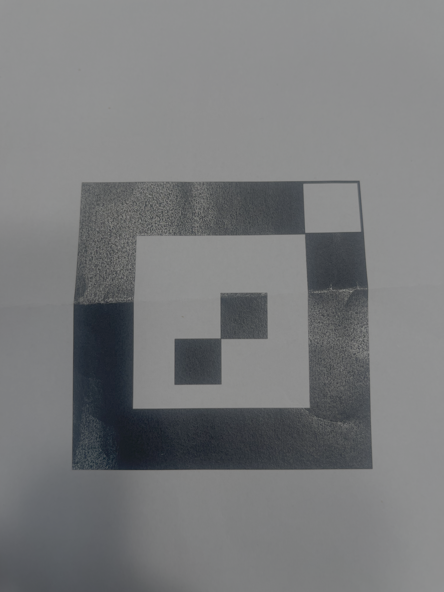

## Custom Fiducial Marker
The application uses a custom fiducial marker.

## PoseEstimator
**PoseEstimator – Beräkning av markörens position och avstånd**
PoseEstimator används för att beräkna markörens position i förhållande till kameran. Komponenten använder OpenCV:s funktion `solvePnP` för att uppskatta markörens position i tre dimensioner (X, Y och Z).

**Indata och markörstorlek**
För att göra beräkningen behövs markörens fyra hörn i kamerabilden, markörens verkliga storlek och kamerans kalibreringsvärden.

**Beräkning av position**
Eftersom hörnen som skickas från MarkerRecognizer har skalats upp använder vi funktionen `estimatePoseFromScaledCorners` för att återställa deras ursprungliga positioner innan positionsberäkningen görs.
Därefter använder `estimatePose` OpenCV:s funktion `solvePnP` för att beräkna markörens position i förhållande till kameran.

**Avståndsberäkning**
Funktionen `distanceToMarker` beräknar avståndet mellan kameran och markören med hjälp av dess X-, Y- och Z-koordinater.
Avståndet beräknas med formeln: `distance = sqrt(x² + y² + z²)`
Det beräknade avståndet skickas vidare till AudioController, där det används för att styra ljudets tonhöjd.

## AudioController
**AudioController – Ljudstyrning med markören**
AudioController ansvarar för att styra ljudet utifrån markörens avstånd och rotation. Komponenten använder biblioteket SFML 3 för att generera och spela upp ljud.
När programmet startar skapas en ton med frekvensen 440 Hz direkt i koden. Därför behövs inga externa ljudfiler.

**Avstånd och tonhöjd**
Markörens avstånd till kameran används för att ändra tonhöjden. När markören kommer närmare kameran blir tonen högre, och när den flyttas längre bort blir tonen lägre.
I koden används ett avståndsintervall mellan 0,2 och 1,0 meter. Avstånd utanför intervallet begränsas till närmaste gränsvärde.

**Rotation och volym**
Markörens rotation används för att ändra ljudvolymen. AudioController jämför den aktuella rotationsvinkeln med den föregående och justerar volymen utifrån skillnaden.
Volymen begränsas till intervallet 0–40 %.

**När ljudet stoppas**
Ljudet stoppas automatiskt om markören inte längre identifieras eller om programmet får ett ogiltigt avstånds- eller rotationsvärde.
För att kunna undersöka varför ljudet stoppades finns även funktionen getStopReason(), som returnerar orsaken. Detta används bland annat vid testning av AudioController.

